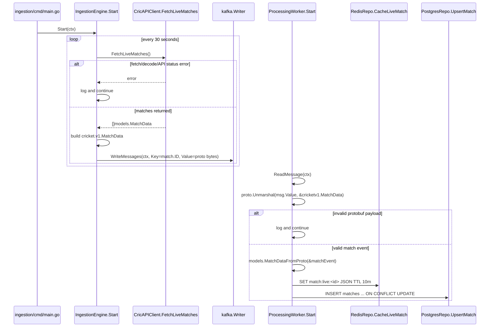
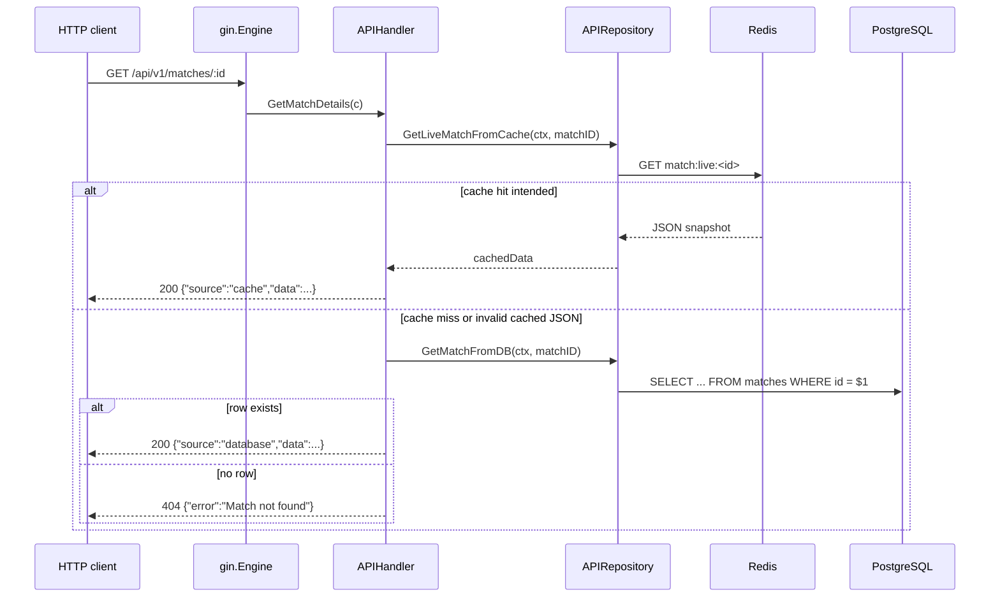

# Onboarding to Overcast

This document is for someone who has just cloned this repository and wants to understand the shape of the system before making a first change. Overcast is small enough that you can read the whole codebase in one sitting, but it still has a real distributed-systems shape: one service polls an external cricket API, one service consumes and persists match events, and one service exposes those persisted matches over HTTP.

## What This Project Actually Is

Overcast is a Go microservice workspace for live cricket match data. Its core job is to keep asking CricAPI for currently active matches, turn each match into a typed internal event, push those events through Kafka, and maintain two queryable views of the latest state: Redis for short-lived live match snapshots and PostgreSQL for durable match records.

The central unit of work is a match update. In `services/ingestion/internal/api/client.go`, `CricAPIClient.FetchLiveMatches` calls `https://api.cricapi.com/v1/currentMatches` and decodes the response into `internal/models.MatchData`. In `services/ingestion/internal/producer/engine.go`, `IngestionEngine.Start` wakes up every 30 seconds, converts each match into `cricket.v1.MatchData`, marshals that protobuf message, and writes it to the Kafka topic configured by `KAFKA_TOPIC`. The processing service then consumes those protobuf messages, converts them back into `internal/models.MatchData`, and writes the same logical match into Redis and PostgreSQL. The API service is the read side of that pipeline.

That split matters because this is not a request-response app where the API server fetches live data on demand. The query API assumes another process has already built the read model. If `/api/v1/matches/:id` is fast, it is because `services/processing` has already refreshed `match:live:<id>` in Redis or upserted a row into the `matches` table.

## Where It's Used, and By Whom

There are no README, ADOPTERS, USERS, MAINTAINERS, CODEOWNERS, or CONTRIBUTING files in this checkout, and the available `.git` directory is not usable as a normal Git repository from this workspace, so local history and contributor information could not be inspected. A quick public search for `github.com/mildlybrutal/overcast cricket kafka` did not turn up a matching public project page or adopter list. The safest reading is that this is an early or private project rather than a broadly adopted open source package.

That affects how you should approach contributions. There is not yet a documented maintainer workflow, issue label system, migration policy, or deployment guide to defer to. The code itself is the contract today, and part of improving the project is likely to be making those contracts explicit.

## Tech Stack

The repo is organized as a Go workspace in `go.work`, with separate modules for generated protobuf code, shared domain models, and each service. The service boundaries are real: ingestion, processing, and API each have their own `go.mod` and `cmd/main.go`, which makes it natural to build and deploy them independently even though local development can use the workspace to resolve local module replacements.

Kafka is the backbone between ingestion and processing. That choice fits the shape of the data because match updates are event-like: the ingestion service does not need to know whether Postgres, Redis, or some future fan-out consumer handled a match. It only needs to publish a keyed message. The processing service owns the downstream consequences of that message.

Protocol Buffers sit on the Kafka boundary through `proto/cricket/v1/match.proto` and `gen/cricket/v1/match.pb.go`. Inside HTTP-facing and repository code, the project mostly works with Go structs from `internal/models/event.go`; at the message-bus boundary, it uses the generated `cricket.v1.MatchData` type. That separation gives contributors one place to change the wire schema and one place to change the in-process domain representation.

Redis and PostgreSQL serve different read needs. Redis stores live match snapshots under keys like `match:live:<id>` with a 10-minute TTL, while PostgreSQL stores durable rows in the `matches` table. The API's single-match endpoint is intended to read Redis first and fall back to PostgreSQL, while the list endpoint always reads recent matches from PostgreSQL.

Gin is used only in the query service, where it keeps the HTTP layer compact: `services/api/cmd/main.go` creates the router, `services/api/internal/handler/router.go` registers routes, and the handler delegates storage reads to `APIRepository`.

## Libraries and Why They're Here

The most important runtime dependency is `github.com/segmentio/kafka-go`, used by both `services/ingestion/internal/producer/engine.go` and `services/processing/internal/consumer/worker.go`. It gives the project a native Go Kafka writer and reader without adding a JVM sidecar or binding the services to a heavier framework. The writer uses `kafka.LeastBytes` balancing and keys messages by match ID, while the reader is configured with a consumer group ID so processing can scale as a group.

`google.golang.org/protobuf` is the serialization layer on Kafka. The `.proto` file defines `MatchScore`, `MatchData`, and `CricketAPIResponse`, and the generated Go module in `gen` exposes those as `cricketv1` types. The hand-written model conversion functions in `internal/models/event.go` are the narrow bridge between generated wire structs and ordinary Go structs.

The API service uses `github.com/gin-gonic/gin` for routing and JSON responses. There is not much framework ceremony here: the project relies on Gin for route grouping, CORS-style response headers, path parameters, and JSON rendering, while the real storage logic remains in `services/api/internal/repository/db.go`.

PostgreSQL access is split between two drivers. The processing service imports `github.com/jackc/pgx/v5/stdlib` and opens SQL connections with driver name `pgx`, while the API service imports `github.com/lib/pq` indirectly in its module file but currently calls `sql.Open("postgres", ...)` without a blank import in `services/api/internal/repository/db.go`. That is a rough edge to notice if API startup fails with an unknown SQL driver error.

Redis access uses `github.com/redis/go-redis/v9` in both the processing and API repositories. Processing writes JSON snapshots with a TTL in `CacheLiveMatch`; the API reads those same keys in `GetLiveMatchFromCache`.

## Core Architecture

There are three concepts that make the rest of this codebase click.

The first is the match event. `internal/models.MatchData` is the domain shape received from CricAPI and used by the repositories, while `cricket.v1.MatchData` is the protobuf shape carried across Kafka. The fields are nearly the same, but the conversion boundary is deliberate: external JSON, internal Go structs, and Kafka bytes should not be treated as the same thing just because they describe the same cricket match.

The second is the event pipeline. Ingestion is allowed to know about CricAPI and Kafka, but it does not know about Redis or PostgreSQL. Processing is allowed to know about Kafka, Redis, and PostgreSQL, but it does not know about CricAPI. The API is allowed to know about Redis and PostgreSQL, but it does not know about CricAPI or Kafka. That separation is what lets the system keep polling and processing in the background while HTTP clients only talk to a query surface.

The third is the read model. Redis is the short-lived live view, PostgreSQL is the durable match list and fallback store, and the API service sits on top of both. If you are adding a new query endpoint, you should first ask whether that endpoint needs a live cache lookup, a durable database query, or both. If you are adding a new field from CricAPI, you need to carry it through the model, protobuf schema, processing writes, and API reads before clients will see it reliably.

### Architecture Diagram

```mermaid
flowchart LR
    CricAPI["CricAPI currentMatches<br/>services/ingestion/internal/api/client.go"] -->|"FetchLiveMatches() JSON -> models.MatchData"| Ingestion["IngestionEngine.Start<br/>services/ingestion/internal/producer/engine.go"]
    Ingestion -->|"proto.Marshal(cricket.v1.MatchData)<br/>Kafka key = match.ID"| Kafka[("Kafka topic<br/>raw-match-events")]
    Kafka -->|"kafka.Reader.ReadMessage(ctx)"| Worker["ProcessingWorker.Start<br/>services/processing/internal/consumer/worker.go"]
    Worker -->|"MatchDataFromProto(&matchEvent)"| Model["internal/models.MatchData<br/>internal/models/event.go"]
    Model -->|"CacheLiveMatch(ctx, match)<br/>SET match:live:<id> TTL 10m"| Redis[("Redis")]
    Model -->|"UpsertMatch(match)<br/>INSERT ... ON CONFLICT"| Postgres[("PostgreSQL matches table")]
    Client["HTTP client"] -->|"GET /api/v1/matches<br/>GET /api/v1/matches/:id"| API["APIHandler<br/>services/api/internal/handler/router.go"]
    API -->|"GetLiveMatchFromCache(matchID)"| Redis
    API -->|"ListMatchesFromDB()<br/>GetMatchFromDB(matchID)"| Postgres
```



## How Data and Requests Actually Flow Through the System

The write path starts in `services/ingestion/cmd/main.go`. It requires `CRICKET_API_KEY`, then defaults `KAFKA_BROKER` to `localhost:9092` and `KAFKA_TOPIC` to `raw-match-events` if those are not provided. It creates a cancellable context, wires `SIGINT` and `SIGTERM` into cancellation, creates an `IngestionEngine`, and calls `engine.Start(ctx)`.

`IngestionEngine.Start` is a loop around a 30-second ticker. Every tick, it calls `CricAPIClient.FetchLiveMatches`. Network errors, non-200 responses, failed JSON decoding, or a non-`success` API status are logged and skipped for that tick. For each returned match, the engine manually builds a `cricketv1.MatchData`, marshals it with `proto.Marshal`, and writes it to Kafka. One implementation detail to notice: the code assigns `payload, err := proto.Marshal(matchProto)` but does not check that marshal error before calling `WriteMessages`, so a contributor tightening reliability should start there.

The processing path starts in `services/processing/cmd/main.go`. It reads Kafka, Postgres, and Redis settings from the environment, opens both repositories, and starts a `ProcessingWorker`. The worker blocks on `pw.reader.ReadMessage(ctx)`, unmarshals the Kafka value into `cricketv1.MatchData`, converts it to `models.MatchData`, writes Redis first, then writes PostgreSQL. Redis and Postgres write failures are logged independently, so a Redis failure does not stop the Postgres upsert and a Postgres failure does not stop the worker from reading the next Kafka message.

The query path starts in `services/api/cmd/main.go`. The API service defaults to `localhost:5432`, `localhost:6379`, and port `8080`, then constructs an `APIRepository` and registers two routes. `GET /api/v1/matches` calls `ListMatchesFromDB` and returns up to 50 rows ordered by `updated_at`. `GET /api/v1/matches/:id` is intended to call Redis first through `GetLiveMatchFromCache`, return a `"source": "cache"` response when JSON is available, and fall back to `GetMatchFromDB` when the cache misses.

There is a current bug in that cache fallback path. In `services/api/internal/repository/db.go`, `GetLiveMatchFromCache` checks `if err != redis.Nil` and returns an empty string even when Redis returned a value successfully. The condition should distinguish `err == redis.Nil`, `err != nil`, and `err == nil`; as written, the API will effectively miss the cache and fall back to PostgreSQL. That is useful context for a first bugfix because the intended architecture and the current behavior differ.

### Ingestion and Processing Flow



### API Read Flow



## Repository Layout — What Lives Where

This repository is organized around deployable services and the small set of shared contracts they need to agree on.

```text
.
├── docker-compose.yaml
├── go.work
├── gen/
│   ├── go.mod
│   └── cricket/v1/match.pb.go
├── internal/
│   └── models/
│       ├── go.mod
│       └── event.go
├── proto/
│   └── cricket/v1/match.proto
└── services/
    ├── api/
    │   ├── Dockerfile
    │   ├── cmd/main.go
    │   └── internal/
    │       ├── handler/router.go
    │       └── repository/db.go
    ├── ingestion/
    │   ├── Dockerfile
    │   ├── cmd/main.go
    │   └── internal/
    │       ├── api/client.go
    │       └── producer/engine.go
    └── processing/
        ├── Dockerfile
        ├── cmd/main.go
        └── internal/
            ├── consumer/worker.go
            └── repository/
                ├── postgres.go
                └── redis.go
```

`proto/` is where the Kafka contract starts. If you need to add a field to the match event, change `proto/cricket/v1/match.proto` first, regenerate `gen/cricket/v1/match.pb.go`, and then update the model conversion code. Do not hand-edit the generated file; it is marked as generated by `protoc-gen-go`.

`gen/` is its own Go module because the generated package has a public import path, `github.com/mildlybrutal/overcast/gen/cricket/v1`. The service modules use local `replace` directives so they can import that generated package while developing inside this repo.

`internal/models/` is the shared domain model module. This is the code you touch when the in-process representation of a cricket match changes. It is also where the project translates between generated protobuf types and ordinary Go structs.

`services/ingestion/` owns external input. It knows how to call CricAPI and publish Kafka messages, and it should remain ignorant of database schema details. If you are changing polling cadence, CricAPI request behavior, Kafka keys, or the conversion from API response to protobuf event, this is the service to read.

`services/processing/` owns the write side of the read model. It consumes Kafka messages, converts protobuf to domain structs, writes live JSON snapshots to Redis, and upserts durable records into PostgreSQL. If you add a new storage target, retry strategy, or schema migration approach, this service is where that work naturally lands.

`services/api/` owns HTTP reads. `handler/router.go` is the outward-facing contract, and `repository/db.go` is the storage access layer. If you add an endpoint, keep the handler focused on HTTP concerns and put the actual Redis/Postgres query in the repository.

`docker-compose.yaml` is intended to describe the local multi-service environment, but it is currently incomplete. It references `postgres`, `redis`, and Kafka health checks that are not defined in the file, sets `KAFKA_BROKER=kafka:29092` even though the Kafka service only declares `9092`, and points to an empty `services/ingestion/Dockerfile`. Treat the compose file as a starting point, not a working local environment.

## What You Should Know Before You Start

You should be comfortable with Kafka consumer-group semantics before changing `services/processing/internal/consumer/worker.go`. The code uses `ReadMessage(ctx)` with a configured `GroupID`, which means offset commits and scaling behavior are delegated to `kafka-go`'s reader behavior. That matters if you add retries or move writes around, because the point at which a message is considered handled affects whether match updates can be dropped, duplicated, or replayed.

You should understand Protocol Buffers as a schema contract, not just a serialization library. `proto/cricket/v1/match.proto` is the wire contract between services. Changing a field name, type, or number has different compatibility consequences than changing a Go struct tag in `internal/models/event.go`.

You should understand the difference between a live cache and a durable store. Redis entries expire after 10 minutes, so the API must never rely on Redis as the only source of truth. PostgreSQL is the fallback and list source, but the current table schema stores `score_json` while only upserting status and score on conflict. If you expect venue, teams, or match type changes to be reflected after the first insert, you need to adjust the upsert.

You should also be aware that local build metadata is inconsistent. The workspace and modules declare Go `1.26.4`, while the Dockerfiles use `golang:1.22-alpine`. The API module path is `overcast/services/api`, while the other modules use `github.com/mildlybrutal/overcast/...`. The code currently passes `go test ./...` in each module, but packaging and container builds will need attention before this is smooth for a new contributor.

## Getting Your Bearings for a First Contribution

A practical first contribution would be to make the local environment honest: add Postgres, Redis, the processing service, and usable Kafka health checks to `docker-compose.yaml`, then give ingestion a real Dockerfile. That work would immediately help every future contributor.

If you prefer a smaller code change, fix `GetLiveMatchFromCache` in `services/api/internal/repository/db.go` so it returns cached values correctly on Redis hits, then add a focused unit test around hit, miss, and Redis-error behavior. Another useful improvement is checking the `proto.Marshal` error in `services/ingestion/internal/producer/engine.go` before publishing to Kafka.

For feature work, start with one field and carry it end to end: add it to `proto/cricket/v1/match.proto`, regenerate the protobuf code, update `internal/models/event.go`, persist it in `services/processing/internal/repository/postgres.go`, and return it through the API repository. That path will teach you the whole system without forcing you to redesign it.
