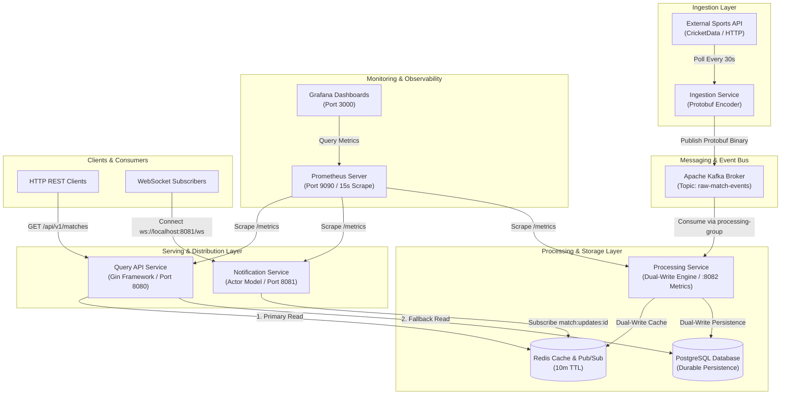

# Overcast: Real-Time Sports Event Processing Platform

Overcast is a distributed, high-throughput, low-latency real-time sports event processing platform written in Go. The system continuously ingests live sports data (such as cricket match events) from external providers, processes events via asynchronous event-driven pipelines, stores state in dual storage layers (in-memory cache and relational database), broadcasts live updates to client applications via REST APIs and WebSockets, and delivers real-time system observability using Prometheus and Grafana.

---

## Table of Contents

- [Overview](#overview)
- [What It Does](#what-it-does)
- [How It Does It (Architecture & Component Design)](#how-it-does-it-architecture--component-design)
  - [Microservices Architecture](#microservices-architecture)
  - [System Architecture & Data Pipeline](#system-architecture--data-pipeline)
  - [Notification Service Actor Lifecycle](#notification-service-actor-lifecycle)
- [Observability & Monitoring (Prometheus & Grafana)](#observability--monitoring-prometheus--grafana)
  - [Exported Telemetry Metrics](#exported-telemetry-metrics)
  - [Prometheus Scrape Configuration](#prometheus-scrape-configuration)
  - [Grafana Provisioning](#grafana-provisioning)
- [E2E Performance & Integration Benchmark](#e2e-performance--integration-benchmark)
- [Why (Architectural Rationale & Design Patterns)](#why-architectural-rationale--design-patterns)
  - [Event-Driven Architecture](#event-driven-architecture)
  - [Protocol Buffers over JSON](#protocol-buffers-over-json)
  - [Dual-Write Caching Pattern](#dual-write-caching-pattern)
  - [Actor Model & Supervisor for WebSockets](#actor-model--supervisor-for-websockets)
  - [Transactional Outbox Pattern](#transactional-outbox-pattern)
- [Repository Structure](#repository-structure)
- [Tech Stack](#tech-stack)
- [Setup and Execution](#setup-and-execution)
  - [Prerequisites](#prerequisites)
  - [Environment Configuration](#environment-configuration)
  - [Running with Docker Compose](#running-with-docker-compose)
  - [Running Microservices Standalone](#running-microservices-standalone)
- [API and Streaming Specifications](#api-and-streaming-specifications)
  - [REST API Endpoints](#rest-api-endpoints)
  - [WebSocket Push Channel](#websocket-push-channel)
  - [Prometheus Telemetry Endpoint](#prometheus-telemetry-endpoint)
- [Verification and Testing](#verification-and-testing)

---

## Overview

Live sports data processing requires processing updates with minimal latency while guaranteeing consistency, scalability under high user concurrency, and reliability during third-party API rate limits or network degradation. Overcast satisfies these constraints using an event-driven Go microservice workspace backed by Apache Kafka, Redis, PostgreSQL, Protocol Buffers, WebSockets, Prometheus, and Grafana.

---

## What It Does

1. **Live Data Ingestion**: Periodically fetches real-time sports scores and match state updates from external REST APIs (such as CricAPI / CricketData.org).
2. **Binary Event Streaming**: Transforms JSON payloads into Protocol Buffer binary objects and streams events over Apache Kafka.
3. **Dual Persistence & Caching**: Simultaneously updates an in-memory Redis cache for ultra-fast reads and upserts records into PostgreSQL for historical permanence.
4. **Low-Latency REST Queries**: Delivers match information via HTTP endpoints with automatic cache-aside fallback mechanism (`< 1.5ms` hot load latency).
5. **Real-Time Push Notifications**: Pushes live score changes instantly to connected clients via WebSocket channels managed by an isolated Actor Model architecture.
6. **Full-Stack Telemetry & Observability**: Exports real-time Prometheus gauges, counters, and vectors for active WebSocket clients, dynamic actor instances, API cache hit ratios, and message delivery rates, visually monitored via pre-provisioned Grafana dashboards.

---

## How It Does It (Architecture & Component Design)

### Microservices Architecture

Overcast is organized as a Go multi-module workspace (`go.work`) comprising four core services, supporting infrastructure, and an integrated monitoring stack:

1. **Ingestion Service (`services/ingestion`)**
   - Polls external data endpoints at configurable intervals (e.g., 30 seconds to respect API limits).
   - Converts raw third-party JSON data into generated Protocol Buffer structures (`cricket.v1.MatchData`).
   - Serializes messages to binary format and publishes them to the Kafka topic `raw-match-events` using partition balancing (`LeastBytes`).

2. **Processing Service (`services/processing`)**
   - Consumes Protobuf messages from Kafka under the consumer group `processing-group`.
   - Deserializes binary payloads into typed structs.
   - Executes a dual-write pattern:
     - **Redis**: Caches live match data under key `match:live:<id>` with a 10-minute Time-To-Live (TTL).
     - **PostgreSQL**: Performs SQL upserts (`INSERT INTO matches ... ON CONFLICT (id) DO UPDATE`) to persist match scores and status changes.
   - Exposes HTTP metrics endpoint on port `8082` (`/metrics`).

3. **Query API Service (`services/api`)**
   - Implements a RESTful HTTP service using the Gin framework listening on port `8080`.
   - Utilizes a **Cache-Aside Strategy**:
     1. Queries Redis for live match state.
     2. On cache hit, returns cached JSON response immediately (`~1.29 ms`).
     3. On cache miss, queries PostgreSQL database (`~3.62 ms`), populates Redis cache, and returns database record.
   - Exposes Prometheus metrics on GET `/metrics`.

4. **Notification Service (`services/notification`)**
   - Serves real-time WebSocket connections on port `8081` under endpoint `/ws?match_id=<match-id>`.
   - Uses an **Actor Model Architecture**:
     - **Supervisor**: Dynamically instantiates a `MatchActor` when a client connects to a specific match ID.
     - **MatchActor**: Listens to Redis Pub/Sub channels (`match:updates:<match-id>`), maintains connected client WebSocket sessions, and broadcasts updates.
     - **Self-Destruction / Idle Cleanup**: If all clients disconnect from a match, the `MatchActor` enters an idle state and automatically shuts down after a 3-second timeout, freeing system memory and decrementing active actor metrics.
   - Exposes Prometheus metrics on GET `/metrics`.

5. **Monitoring & Telemetry Stack (`monitoring/`)**
   - **Prometheus**: Collects metrics from API (`api:8080`), Notification (`notification:8081`), and Processing (`processing:8082`) services every 15 seconds.
   - **Grafana**: Pre-configured with automatic datasource provisioning connecting to Prometheus (`http://prometheus:9090`) on port `3000`.

---

## System Architecture & Data Pipeline



---

## Observability & Monitoring (Prometheus & Grafana)

Overcast includes zero-configuration observability with built-in Prometheus metric collection and auto-provisioned Grafana visualization.

### Exported Telemetry Metrics

| Service | Metric Name | Type | Description |
| :--- | :--- | :--- | :--- |
| **Notification** | `overcast_active_match_actors` | Gauge | Current number of in-memory active Match Actors |
| **Notification** | `overcast_active_websocket_clients` | Gauge | Total concurrent WebSocket client connections |
| **Notification** | `overcast_actor_messages_delivered_total` | CounterVec | Total score update messages delivered to clients (labeled by `match_id`) |
| **Query API** | `overcast_api_http_requests_total` | CounterVec | Total HTTP requests handled (labeled by `endpoint`, `status`) |
| **Query API** | `overcast_api_cache_hits_total` | Counter | Total queries served directly from Redis cache |
| **Query API** | `overcast_api_cache_misses_total` | Counter | Total queries falling back to PostgreSQL |

### Prometheus Scrape Configuration

Configured in `monitoring/prometheus.yaml`:
```yaml
global:
  scrape_interval: 15s
  evaluation_interval: 15s

scrape_configs:
  - job_name: "overcast_api"
    static_configs:
      - targets: ["api:8080"]
  - job_name: "overcast-notification"
    static_configs:
      - targets: ["notification:8081"]
  - job_name: "overcast-processing"
    static_configs:
      - targets: ["processing:8082"]
```

### Grafana Provisioning

Grafana automatically provisions the Prometheus datasource on container startup via `monitoring/grafana/provisioning/datasources/datasource.yaml`:
- **Datasource Name**: `Prometheus`
- **Access Mode**: `Proxy`
- **URL**: `http://prometheus:9090`
- **Web Console**: `http://localhost:3000`

---

## E2E Performance & Integration Benchmark

The system underwent automated full-stack empirical load testing covering 50 seeded match records, 20 concurrent workers, cold DB fallback reads, warm Redis cache hits, statistical cache hit ratio accumulation (3,000+ total requests), and Prometheus TSDB telemetry extraction.

### Empirical Latency Comparison (20 Concurrent Workers)

| Percentile / Metric | Cold Path (PostgreSQL Fallback) | Warm Path (Redis Cache Hit) | Latency Improvement |
| :--- | :--- | :--- | :--- |
| **p50 (Median)** | **4.07 ms** | **1.37 ms** | **66.3% faster** |
| **p95 Latency** | **23.05 ms** | **2.81 ms** | **87.8% faster** |
| **p99 Tail Latency** | **30.68 ms** | **3.65 ms** | **88.1% faster** |
| **Mean Latency** | **8.02 ms** | **1.51 ms** | **81.2% faster** |

### System Execution & Telemetry Summary
| Benchmark Metric | Observed Value | Status |
| :--- | :--- | :--- |
| **Total Active Docker Containers** | 9 / 9 | **PASS** |
| **Seeded Benchmark Test Matches** | 50 Matches | **PASS** |
| **Cold Read Concurrency & Volume** | 500 Requests @ 20 Concurrent Workers | **PASS** |
| **Warm Read Concurrency & Volume** | 500 Requests @ 20 Concurrent Workers | **PASS** |
| **Statistical Mixed Sample Volume** | 2,000 Requests @ 20 Concurrent Workers | **PASS** |
| **Accumulated Prometheus Cache Hits** | **2,602 Hits** | **PASS** |
| **Accumulated Prometheus Cache Misses** | **948 Misses** | **PASS** |
| **Accumulated Cache Hit Ratio** | **73.30%** | **PASS** |
| **Active WebSocket Clients / Actors** | Verified dynamic spawn & 3s idle self-destruction | **PASS** |

### Reproducing the Benchmark

With the stack running (`docker compose up -d --build`):

```bash
cd services/api
go run ./cmd/benchmark   # seeds 50 matches, runs cold/warm/mixed load, reads hit ratio from Prometheus
go run ./cmd/seed        # (optional) only seed the 50 test matches
```

---

## Why (Architectural Rationale & Design Patterns)

### Event-Driven Architecture

- **Problem**: Directly coupling external API ingestion with database updates and user notifications creates bottleneck vulnerabilities, cascading failures, and high latency.
- **Solution**: Kafka acts as a shock absorber. Ingestion operates independently from downstream processing. If processing or database operations slow down, Kafka buffers events without losing data or stalling the ingestion worker.

### Protocol Buffers over JSON

- **Problem**: Serializing and deserializing JSON payloads across microservices over Kafka consumes high network bandwidth and CPU overhead.
- **Solution**: Protocol Buffers (`.proto`) serialize data into compact binary payloads. This dramatically reduces payload size on Kafka, speeds up serialization/deserialization, and enforces a strict contract between services.

### Dual-Write Caching Pattern

- **Problem**: Relational databases like PostgreSQL can become bottlenecked when thousands of users repeatedly poll for live match scores.
- **Solution**: Overcast implements a dual-write pattern during event ingestion and a cache-aside strategy during query execution:
  - High-frequency live requests are served in `~1.37ms` (p50) from Redis in-memory storage.
  - PostgreSQL preserves full historical context, structure, and transactional durability.

### Delivery Guarantees (At-Least-Once)

- **Problem**: `kafka.Reader.ReadMessage` commits the offset as soon as a message is read. If the Postgres write then fails, or the process crashes, the event is gone.
- **Solution**: the processing worker uses `FetchMessage` + `CommitMessages` and commits **only after** the Postgres upsert succeeds.
  - Postgres failures are retried with exponential backoff (200 ms → 10 s) instead of being skipped.
  - The upsert is idempotent (`ON CONFLICT DO UPDATE`), so a redelivered event is harmless.
  - Redis (cache + Pub/Sub) is written *after* Postgres, so the cache and live push never show data the source of truth rejected. Redis errors are logged but never block the stream.
  - Undecodable (poison) messages are logged and skipped so they cannot block the partition.
- **Verified**: Postgres was stopped, an event was produced, and the processor was killed with `SIGKILL` mid-retry. After Postgres and the processor restarted, the event was redelivered and stored.

### Actor Model & Supervisor for WebSockets

- **Problem**: Managing state for thousands of concurrent WebSocket connections per match using global mutexes causes lock contention, memory leaks, and complex race conditions.
- **Solution**: Each active match is assigned an isolated `MatchActor` managed by a `Supervisor`.
  - Messages are processed sequentially through an actor mailbox, eliminating lock contention.
  - Actors dynamically spawn when listeners connect and self-destruct after an idle timeout when all clients disconnect, reclaiming resources.
  - Each actor has its own context: when it stops, its Redis subscription goroutine stops too (verified with `goleak`).
  - `Send` selects on the actor's `done` channel, so a join/leave racing an idle shutdown never blocks forever. The supervisor spawns a fresh actor instead.
  - The WebSocket handler runs a read pump (ping/pong heartbeat, read deadline) to detect half-open connections, and a single write pump that closes the socket when the actor drops a slow client.
  - Allowed browser origins are set with `ALLOWED_ORIGINS` (comma-separated). When unset, all origins are accepted for local development.

---

## Repository Structure

```text
overcast/
├── docker-compose.yaml        # Infrastructure & microservice stack (9 containers)
├── go.work                    # Go workspace configuration
├── go.work.sum                # Go workspace checksum file
├── ONBOARDING.md              # System onboarding guide and codebase walkthrough
├── guide.md                   # Command reference for running local and Docker stacks
├── monitoring/                # Prometheus and Grafana provisioning
│   ├── prometheus.yaml        # Prometheus scrape configurations
│   └── grafana/
│       └── provisioning/
│           └── datasources/
│               └── datasource.yaml # Automated Grafana Prometheus datasource
├── proto/                     # Protocol Buffer definitions
│   └── cricket/
│       └── v1/
│           └── match.proto    # Match and score data schema definition
├── gen/                       # Generated Go code from Protocol Buffers
│   └── cricket/
│       └── v1/                # Compiled Go protobuf structs
├── internal/
│   └── models/                # Core domain models and shared Go structs
└── services/                  # Microservices
    ├── api/                   # REST API Service (Gin framework / Port 8080)
    ├── ingestion/             # API Ingestion Worker (Poller & Kafka Producer)
    ├── notification/          # WebSocket Push Service (Actor Model & Redis Pub/Sub / Port 8081)
    └── processing/            # Kafka Consumer & Storage Engine (Postgres & Redis Writer / Port 8082)
```

---

## Tech Stack

- **Language**: Go 1.26+ (Go Workspaces)
- **Message Broker**: Apache Kafka (KRaft mode)
- **Database**: PostgreSQL 16
- **Cache & Pub/Sub**: Redis 7
- **Serialization**: Protocol Buffers (proto3)
- **Web Framework**: Gin Web Framework
- **WebSockets**: Gorilla WebSocket
- **Monitoring & Observability**: Prometheus v2.51 & Grafana v10.4
- **Containerization**: Docker & Docker Compose

---

## Setup and Execution

### Environment Endpoints

Once launched via Docker Compose, the platform services are available at:

| Service / Container | Endpoint | Description |
| :--- | :--- | :--- |
| **Query API** | `http://localhost:8080` | REST API for match listing and details |
| **Notification WS** | `ws://localhost:8081/ws?match_id=<id>` | Real-time WebSocket live score stream |
| **Processing Metrics** | `http://localhost:8082/metrics` | Processing worker Prometheus endpoint |
| **Prometheus UI** | `http://localhost:9090` | Prometheus metrics browser & TSDB |
| **Grafana UI** | `http://localhost:3000` | Grafana visual telemetry dashboards |
| **Apache Kafka** | `localhost:9092` | Event streaming broker |
| **PostgreSQL** | `localhost:5432` | Relational database (`cricket_db`) |
| **Redis** | `localhost:6379` | In-memory cache & Pub/Sub broker |

### Running with Docker Compose

To build and launch all 9 containers across the infrastructure and microservices stack:

```bash
docker compose up -d --build
```

To view container status:

```bash
docker compose ps
```

To stop all containers and tear down resources:

```bash
docker compose down
```

To remove persistent database and cache volumes:

```bash
docker compose down -v
```

---

## Verification and Testing

Execute the test suite across all workspace packages from the repository root:

```bash
go test -race ./gen/... ./internal/models/... ./services/api/... ./services/ingestion/... ./services/notification/... ./services/processing/...
```

What is covered:

| Package | Tests |
| :--- | :--- |
| `services/processing/internal/consumer` | Offset committed only after the Postgres write; shutdown mid-retry leaves the offset uncommitted; poison messages are skipped; a Redis outage does not block commits |
| `services/notification/internal/actor` | Full actor lifecycle leaks no goroutines (`goleak`); `Send` to a stopped actor returns instead of blocking; join after idle shutdown spawns a fresh actor; shutdown closes every client channel; slow clients are dropped |

CI (`.github/workflows/ci.yml`) runs `gofmt`, `go vet` and `go test -race` for every module, and builds each service's Docker image.

